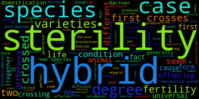

# Assignment 1: Unix and Python

## 1. Number of Subjects

### 1A. Downloading the Files

I used `git pull` in my Terminal to update my local copy of the class GitHub repository and get the latest files. I then used `ls` to see the folders in the repository and `ls Assignment1` to check that the assignment files were there. I found `Assignment_1.md`, `Gesquiere2011_data.csv`, and `TwelveDaysOfChristmas.txt`.

**Commands used:**

```bash
git pull
ls
ls Assignment1
```

### 1B. Number of Samples

Individual 8 was sampled **17 times**, and individual 22 was sampled **5 times**.

To find this, I used `cut -f 1` to extract the first column of the data file, which contains the individual IDs (`maleID`). I then used `grep -w` to find only the rows matching each individual's ID without including other IDs. Finally, I used `wc -l` to count how many matching rows there were. Since each row represents one sample, this tells me how many times each individual was sampled.

**Code used:**

```bash
cut -f 1 Gesquiere2011_data.csv | grep -w 8 | wc -l
cut -f 1 Gesquiere2011_data.csv | grep -w 22 | wc -l
```

**Results:**
- Individual 8: 17 samples
- Individual 22: 5 samples


### 1C. Script to Count Samples

For this question, I created a Bash script called `CountSamples.sh` that takes a filename and an individual ID and counts how many times that individual was sampled.

**Script (`CountSamples.sh`):**

```bash
#!/bin/bash

cut -f 1 "$1" | grep -w "$2" | wc -l
```

**Explanation:**

I used `#!/bin/bash` at the beginning to identify the file as a Bash script. I then used `cut -f 1` to select the first column of the data file, which contains the individual IDs (`maleID`). The `$1` represents the filename entered when running the script.

Next, I used `grep -w "$2"` to find the individual ID I want to count. The `$2` represents the ID entered, and `-w` makes sure it matches the whole number rather than part of another ID. Finally, I used `wc -l` to count how many matching rows there were. The pipes (`|`) connect the commands so the output from one command becomes the input for the next.

**Commands used to test the script:**

```bash
bash CountSamples.sh Gesquiere2011_data.csv 8
bash CountSamples.sh Gesquiere2011_data.csv 22
```

**Results:**

When I tested the script with individual 8, I got 17 samples. When I changed the ID to 22, I got 5 samples. Both results matched what I found in Question 1B, showing that the script worked for different individuals.


### 1D. Number of Samples for Every Individual

For this question, I used Python to count how many times each individual was sampled in `Gesquiere2011_data.csv`. I saved my Python script as `CountAllSamples.py` and used it to create a new file called `Num_samples.csv`, with one column for the individual ID and another for the number of samples.

**Code used (`CountAllSamples.py`):**

```python
filename = "Gesquiere2011_data.csv"

with open(filename) as f:
    data = f.read()

rows = data.split("\n")

ids = []

for row in rows[1:]:
    if row != "":
        values = row.split()
        ids.append(values[0])

counts = {}

for individual in ids:
    if individual in counts:
        counts[individual] = counts[individual] + 1
    else:
        counts[individual] = 1

with open("Num_samples.csv", "w") as f:
    f.write("maleID,Num_samples\n")

with open("Num_samples.csv", "a") as f:
    for individual in counts:
        f.write(individual + "," + str(counts[individual]) + "\n")
```

**Explanation:**

I started by opening the data file using `with open()` and reading its contents with `.read()`. I then used `.split("\n")` to separate the data into individual rows.

Next, I created an empty list called `ids` to store the individual IDs. I used a `for` loop to go through the rows, starting after the header. The `if` statement skips any empty rows, and `.split()` separates the values in each row. I used `.append()` to add the first value, which is the `maleID`, to my list.

After collecting the IDs, I created an empty dictionary called `counts`. I used another `for` loop to go through the IDs. If an individual was already in the dictionary, I increased their count by one. If they weren't already there, I started their count at one. This allowed me to count how many times every individual appeared in the data.

Finally, I created `Num_samples.csv` using `with open()` and `"w"` to write the column headings. I then used `"a"` to add the results without removing the headings. The `for` loop writes each individual ID and its sample count, separated by a comma. I used `str()` to convert the counts into text and `\n` to put each individual on a new line.

**Command used to run the script:**

```bash
python CountAllSamples.py
```

**Results:**

The script successfully created `Num_samples.csv`, containing 125 individual IDs and their sample counts in two comma-separated columns. I checked the output using JupyterLab and Terminal. Individual 8 had 17 samples, and individual 22 had 5 samples, matching my results from Question 1B.

I also used the following commands to check the output file:

```bash
head -n 6 Num_samples.csv
wc -l Num_samples.csv
```

The first command displayed the column headings and the first five individuals, while the second confirmed that the file contained 126 lines, including the header.


 ## 2. Mining The Origin of Species

### 2A. Downloading the Book

I used the `curl` command in my Terminal to download a text version of *The Origin of Species* from Project Gutenberg. I used the `-o` option to save the book as `OriginOfSpecies.txt` instead of displaying the entire text in Terminal. After downloading it, I used `ls` to check that the file was saved in my `Assignment1` folder.

**Commands used:**

```bash
curl -o OriginOfSpecies.txt https://www.gutenberg.org/cache/epub/1228/pg1228.txt
ls
```

**Result:**

The book downloaded successfully, and I confirmed that `OriginOfSpecies.txt` was in my `Assignment1` folder.

### 2B. Counting Sterility and Isolation

I used Python to find how many times "sterility" and "isolation" appeared in *On the Origin of Species*. First, I used `with open()` to open `OriginOfSpecies.txt` and `.read()` to store the text in a variable called `text`. Then, I used `.count()` to count how many times each word appeared. Since `.count()` is case-sensitive, I counted the lowercase and capitalized versions separately and added them together. Finally, I used `print()` to display the results.

**Code used:**

```python
with open("OriginOfSpecies.txt") as f:
    text = f.read()

sterility = text.count("sterility") + text.count("Sterility")
isolation = text.count("isolation") + text.count("Isolation")

print("Sterility:", sterility)
print("Isolation:", isolation)
```

**Results:**

- Sterility: 97 occurrences
- Isolation: 12 occurrences

These results include both lowercase and capitalized appearances of each word. Based on these counts, Darwin mentioned sterility more frequently than isolation in the book.


### 2C. Finding the Context of Each Word

I used `grep` to find the words "sterility" and "isolation" in *The Origin of Species*. I used `-i` to ignore capitalization and `-w` to search for the whole word. I also used `-B 3` and `-A 3` to include the three lines before and after each matching line. I saved the results in two separate text files using `>`.

**Commands used:**

```bash
grep -i -w -B 3 -A 3 "sterility" OriginOfSpecies.txt > sterility_context.txt
grep -i -w -B 3 -A 3 "isolation" OriginOfSpecies.txt > isolation_context.txt
ls
```

**Results:**

Both commands ran successfully. I used `ls` to confirm that `sterility_context.txt` and `isolation_context.txt` were saved in my `Assignment1` folder. These files contain the matching lines along with the three lines before and after each match, allowing me to see the context in which Darwin discussed these words.

### 2D. Creating Word Clouds

I used Conda to install the `wordcloud` program. Then I used the command-line instructions to create two word clouds using the text files from Question 2C. I made one for "sterility" and another for "isolation."

**Commands used:**

```bash
conda install -c conda-forge wordcloud
wordcloud_cli --help
wordcloud_cli --text sterility_context.txt --imagefile sterility_wordcloud.png
wordcloud_cli --text isolation_context.txt --imagefile isolation_wordcloud.png
ls
```

**Sterility Word Cloud:**



**Isolation Word Cloud:**


**Result:**

Both word clouds were created successfully and saved as PNG files in my `Assignment1` folder.

### 2E. Interpreting the Word Clouds

Based on my word clouds, I disagree with the idea that Darwin did not address how new species form. The sterility word cloud has words like "hybrid," "crosses," and "fertility," while the isolation word cloud includes "selection," "species," and "intercrosses." This shows that Darwin discussed topics related to how species form and how different groups reproduce. Even though the word clouds do not explain everything he wrote, they suggest that he did discuss ideas connected to the formation of new species.


## 3. Twelve Days of Christmas

I wrote a Python script called `TwelveDays.py` to print all 12 verses of *The Twelve Days of Christmas*. First, I created two lists, `days` and `gifts`, to store the names of the days and the gifts for each day. Then, I used a nested `for` loop to print the lyrics. The outer loop goes through each of the 12 days, while the inner loop prints the gifts for that day in reverse order, starting with the newest gift and ending with the partridge in a pear tree. I also used `print()` to add a blank line between each verse.

**Code used:**

```python
days = ["First", "Second", "Third", "Fourth", "Fifth", "Sixth",
        "Seventh", "Eigth", "Ninth", "Tenth", "Eleventh", "Twelfth"]

gifts = ["A Partridge in a Pear Tree",
         "Two Turtle Doves, and",
         "Three French Hens",
         "Four Colly Birds",
         "Five Gold Rings",
         "Six Geese-a-Laying",
         "Seven Swans-a-Swimming",
         "Eight Maids-a-Milking",
         "Nine Ldaies Dancing",
         "Ten Lords-a-Leaping",
         "Eleven Pipers Piping",
         "Twelve Drummers Drumming"]

for i in range(12):
    print("On the", days[i], "day of Christmas my true love gave to me:")
    for j in range(i + 1):
        print(gifts[i - j])
    print()
```

**Result:**

I ran the script in Terminal using:

```bash
python3 TwelveDays.py
```

The script successfully printed all 12 verses of the song. Each verse included the correct gifts in the correct order, and the output matched the lyrics in `TwelveDaysOfChristmas.txt`.